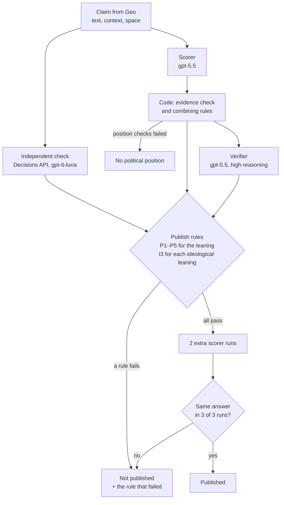
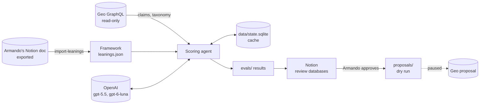

# POLARIS: Political leaning and ideology agent for Geo

POLARIS reads claims from the [Geo](https://www.geobrowser.io) knowledge graph and fills their **Leanings** property. It gives each claim:
- **at most one political leaning**, from Far left to Far right;
- **one or more ideological leanings**: a side of an issue, such as Pro-life or Pro-gun control, or a tradition, such as Conservative or Socialist.

The taxonomy and its definitions come from Armando's Notion doc "Leanings" (in [docs/armando/](docs/armando/leanings-2026-10-23/)).

The project is built for one rule above all: **a wrong label is worse than no label.** A label is published only when several independent checks agree on it; otherwise the claim is left blank and the reason is recorded. Every result can be traced to numbered criteria and to the claim's exact words.

> **Status (26 Oct 2026):** framework v3.3, built on Armando's taxonomy. Nothing is published to Geo: claim submissions are **paused**, and Armando's 86 new issue leanings are not on Geo yet. The latest results are waiting for Armando's review. See [Results so far](#results-so-far).

---

## Contents

1. [What the agent does](#what-the-agent-does)
2. [How one claim is scored](#how-one-claim-is-scored)
3. [The scoring framework](#the-scoring-framework)
4. [What a result looks like](#what-a-result-looks-like)
5. [Architecture](#architecture)
6. [Testing and evaluation](#testing-and-evaluation)
7. [Results so far](#results-so-far)
8. [Review in Notion](#review-in-notion)
9. [Publishing to Geo (paused)](#publishing-to-geo-paused)
10. [Setup](#setup)
11. [Commands](#commands)
12. [Repository layout](#repository-layout)
13. [Versions and history](#versions-and-history)
14. [Open decisions and known limits](#open-decisions-and-known-limits)

---

## What the agent does

For each claim the agent returns:

| Part | What it can be | Example |
|---|---|---|
| **Political leaning** | One of Geo's seven (published), **No label** with the rule that blocked it, or **No political position** with the check that failed | "Abortion is murder" → **Right** |
| **Ideological leanings** | Up to 5: issue leanings and traditions, each published only if it passes its own rules | "Abortion is murder" → **Pro-life, Christian conservative, Conservative** |

There are **no partial labels** such as "Potentially center left". Anything the agent is not sure of is left blank.

**The taxonomy (Armando's doc):**

| Kind | Geo type | Values |
|---|---|---|
| **Political leaning** | Political leaning `efa158a20ac34e63a31de1b103b1e7b0` | Far left, Left, Center left, Center, Center right, Right, Far right. Nonpartisan is proposed for news services and courts; it is never given to a claim. |
| **Issue leanings** | Ideology `bdb20cbb75a644c2bc2aa4d14aeef883` | 86 values, one or two sides per issue, across 42 issues (Abortion: Pro-life / Pro-choice; Guns: Pro-gun control / Pro-gun rights; …). **Not on Geo yet.** |
| **Traditions** | Ideology | 27 values on Geo (Anarchist … Traditionalist), with Armando's new descriptions. Libertarian and Libertarianism are both used. |

**Spaces in scope:** US Politics `4582fbbee28a16589154f7e36f1ee3c5`, Health `52c7ae149838b6d47ce0f3b2a5974546`, Crypto `c9f267dcb0d270718c2a3c45a64afd32`, AI `41e851610e13a19441c4d980f2f2ce6b`, World affairs `89bd89bf28ff8a0963faf92a8c905e20`, Podcasts `b5a31f8182b042437ede0f84ee02f104`, Relationships `224406e0de3c48d78ef12774111b8b2f`.

---

## How one claim is scored

Three different models look at every claim, and code, not a model, decides the result.



1. **Scorer (gpt-5.5).** It reads the framework and the claim (with its Geo space). It reports:
   - the four position checks;
   - the numbered criteria the claim matches, with the claim's exact words as evidence;
   - the ideological leanings it sees: issue + side, or a tradition, again quoted;
   - whether the claim is hedged, and its country.

   It does **not** choose the final answer.
2. **Code.** Code drops any evidence that is not word for word in the claim, applies the combining rules, and works out the candidate leaning.
3. **Independent check (OpenAI Decisions API, gpt-6-luna).** One call of 115 questions returns probabilities: that the claim takes a position, for each of the 7 levels, and for each of the 113 ideological leanings. It never sees the scorer's answer.
   - Each issue-leaning question includes Armando's alternative names, which set the scope of that side. It also includes the rule that a claim using the same words while arguing another side does not count.
   - The check is deterministic: identical calls return identical numbers.
4. **Verifier (gpt-5.5, high reasoning).** It checks the candidate leaning, and each ideological leaning separately, against the full framework. It runs as **2 separate checks**, and a part counts as approved only when both agree.
5. **Second look.** A focused question about any ideological leaning the independent check rates highly (≥ 0.8) but the scorer missed.
6. **Publish rules (code).** P1–P6 for the political leaning; I3 for each ideological leaning (below). Anything that passes must also give the same answer in **3 of 3 scorer runs**. The extra runs are made only when the other rules pass, so they cost little.
7. **Near misses (code).** A label the verifier approved that missed only a numeric bar, by less than 0.1, is listed for Armando to approve. It is never published automatically.

Every model call is cached, so scoring the same claim again costs nothing (see [Caching](#caching-and-reproducibility)).

---

## The scoring framework

The rulebook lives in [`src/framework/rubric.ts`](src/framework/rubric.ts) (criteria and rules) and [`src/framework/ideologies.ts`](src/framework/ideologies.ts) (ideological leanings). The ideological leanings are built from [`src/framework/leanings.json`](src/framework/leanings.json), Armando's data. The full text is generated into [docs/FRAMEWORK.md](docs/FRAMEWORK.md) by `npm run cli -- framework`.

The scorer's prompt, the independent check and the verifier are all built from the same source, so changing a rule changes the agent. Every change bumps `FRAMEWORK_VERSION` (now `framework-v3.3`).

### Step 1: does the claim take a political position?

All four checks must pass. Otherwise the result is **No political position**, naming the check that failed.

| Check | Passes when | Fails when |
|---|---|---|
| **G1** Takes a position | The claim argues for or against something ("should", "must", "is wrong", …) | Neutral facts, statistics, predictions, definitions |
| **G2** In its own voice | The position belongs to the claim itself | "X said", "according to", "a study found" |
| **G3** Political subject | Public policy, law, rights, government, the economy, how society is organized | Personal advice, business, technical or medical claims |
| **G4** Contested | Mainstream political camps disagree about it | Shared principles (democracy, rule of law), goals with no means |

### Step 2: match numbered criteria in five topic areas

Each topic area has criteria scored from −3 to +3, one per level:

| Topic area | Covers |
|---|---|
| **ECO** | Taxes, spending, welfare, labour, markets, regulation, housing, healthcare funding |
| **SOC** | Abortion, LGBTQ rights, family, religion in public life, race and identity, drugs |
| **NAT** | Immigration, refugees, citizenship, national identity |
| **LAW** | Policing, courts, guns, the death penalty, voting rules |
| **ENV** | Climate, pollution, energy |

A criterion ID encodes its score: `ECO-2L` is −2 (Left), `NAT-2R` is +2 (Right), `SOC-0` is 0 (Center). Some topics are recorded as **cross-cutting** and never get a political leaning: foreign policy, trade, technology, free speech and government structure. They can still get ideological leanings.

### What each level means (Armando's convention)

The scorer, the independent check and the verifier all receive these rules. They follow Armando's Political leanings table, where **Left** is also called "Liberal (US usage)", **Right** "Conservative (US usage)", and **Center left/right** "lean" or "moderate".

| Level | Rule |
|---|---|
| Far left (−3) | Radical: replaces capitalism or seeks systemic, often revolutionary change; abolishes core institutions such as police, prisons or borders. |
| Left (−2) | The mainstream liberal or progressive position (in the US, what liberals and Democrats typically support), including bold plans such as single-payer healthcare. |
| Center left (−1) | A moderate, lean-left position: a modest or incremental step, or a left-leaning position with explicit centrist limits. |
| Center (0) | Explicitly combines or balances a left and a right position as a compromise. |
| Center right (+1) | A moderate, lean-right position: a modest or incremental step, or a right-leaning position with explicit centrist limits. |
| Right (+2) | The mainstream conservative position (in the US, what conservatives and Republicans typically support), including bold plans such as abolishing a federal department. |
| Far right (+3) | Ultranationalist, nativist or hostile to pluralist institutions: removes rights because of ethnicity, religion or sexuality, imposes religious rule, or ends elections or civil liberties for opponents. |

### Step 3: combining rules

| Rule | What it does |
|---|---|
| **C1** Country context | A position is placed relative to its country's mainstream. The claim's Geo space counts as context (US Politics means the United States). |
| **E1** Evidence | Every criterion and ideological leaning must quote the claim's exact words. |
| **E2** Arguing through effects | A claim that asserts a contested effect of a policy, which is the argument one side makes, takes that side. For example, "Raising the minimum wage kills jobs" argues against raising it. |
| **H1** Hedged wording | "can", "may", "often" cap the score at ±1 (and P2 blocks publishing anyway). |
| **A1** Mixed signals | One topic area left and another right gives no leaning, never Center. |
| **A2** Combining | Several areas pointing the same way are averaged, rounded toward the center. |
| **A3** Center | Center only through a `…-0` criterion; no scored area gives no leaning (cross-cutting). |
| **A4** Far | Far left or Far right only through a ±3 criterion. |
| **A5** Between two levels | If the position sits between two levels, no criterion is matched. |

### Step 4: ideological leanings

**Two kinds, both of Geo type Ideology:**
- **Issue leanings.** 86 values across 42 issues in 5 groups: Economy, Society, Foreign policy, Justice & democracy, and Climate energy & tech. Each is one side of an issue and has Armando's description, alternative names and sometimes a slogan.
- **Traditions.** 27 classic ideologies with Armando's descriptions. Each card also lists the positions characteristic of the tradition, its exclusions, related traditions, and the leanings where it is usually found.

| Rule | Text |
|---|---|
| **I1** Issue leanings | Assigned when the claim itself takes that side of the issue, directly or through an effect that side argues (E2), quoted. Another side, only mentioning the issue, or reporting someone else's side never counts. |
| **I2** Traditions (Armando's convention) | Assigned when the claim's position is characteristic of the tradition (its adherents typically hold it), even if the claim does not name it. A position argued through its effects counts (E2). The topic alone never counts. |
| **I3** Publish | Evidence quoted word for word; the claim takes a position (≥ 0.8); **issue leaning**: its side ≥ 0.9 and every other side of the issue ≤ 0.1; **tradition**: ≥ 0.8 and usually found at the claim's leaning; the verifier agrees in both checks; all 3 runs find it. |
| **I4** How many | At most one political leaning, up to 5 ideological leanings. |
| **I5** Second look | Any ideological leaning the independent check rates ≥ 0.8 gets a focused second look. |

### Step 5: publish rules for the political leaning

| Rule | Passes when |
|---|---|
| **P1** Takes a position | All four position checks pass, and the independent probability that the claim takes a position is ≥ 0.8. |
| **P2** Full match | Every criterion behind the leaning matches directly or closely, and the claim is not hedged. |
| **P3** Country clear | The country or region the claim is about is clear. |
| **P4** Same level | The independent check's most likely level is the same exact level, with probability ≥ 0.7. |
| **P5** Verifier agrees | The verifier agrees with the leaning in both of its 2 checks. |
| **P6** Stable | The scorer gives the same leaning in all 3 runs. |

The thresholds live in `PUBLISH` in [`src/framework/rubric.ts`](src/framework/rubric.ts).

### No-hallucination guard

- **Real evidence only.** Every quote is checked word for word against the claim text; a quote that is not there is dropped.
- **Code writes the explanation.** It is built only from rule texts, numbers and those checked quotes. Before a result is returned, every quoted span is checked again; a result that fails is refused.
- **Model notes are kept apart.** The models' own wording (position-check notes, verifier objections, second-look reasons) goes to a separate field, **Reviewer notes (unverified)**, never into the explanation.
- **Known values only.** Criterion IDs and leaning names are limited to known values by the JSON schema of every model call.

---

## What a result looks like

The 70-claim fresh sample, US Politics, "Abortion is murder":

```
Result:      Right
Ideology:    Pro-life [T1], Christian conservative [T1], Conservative [T2]
Criterion:   SOC-2R (direct) “Abortion is murder”
Rule:        P1 pass: independent probability that the claim takes a position: 0.92
Rule:        P2 pass: the criteria match directly
Rule:        P3 pass: country: United States
Rule:        P4 pass: the independent check gives Right 1.00
Rule:        P5 pass: the verifier agreed
Rule:        P6 pass: all 3 runs gave Right
Why:         Published: Right. SOC-2R matched (direct): “Abortion is murder”. … Ideology: Pro-life (belief T1: “Abortion is murder”, independent probability 1.00). …
```

A claim on a cross-cutting topic can still carry ideological leanings:

```
Result:      No label (cross-cutting)
Ideology:    Dove [T1], Isolationist [T1]
Why:         No label. The claim's position is on a topic that does not line up with left and right (rule A3: X-FOR). Ideology: Dove (…0.99). Ideology: Isolationist (…0.95). Not published: Paleoconservative (the verifier disagreed). …
```

With `--json` the full result is printed, including every rule check, the probabilities, the verifier's verdicts, the repeat runs and the versions used.

---

## Architecture

### Components

| Component | Code | Role |
|---|---|---|
| **Armando's data** | `docs/armando/`, `scripts/import-leanings.mts` | The Notion export, converted into `src/framework/leanings.json` (taxonomy) and `evals/armando-examples.json` (his example claims). The import applies the approved spelling fixes. |
| **Geo read layer** | `src/geo/` | Read-only GraphQL client for `https://api-testnet.geobrowser.io/graphql`, with retries. Loads claims with context, samples at random, and loads the live taxonomy and type definitions. |
| **Framework** | `src/framework/` | The rulebook as data: criteria, level rules, combining and publish rules, ideological leaning cards. `render.ts` turns it into Markdown for docs, Notion and the verifier. |
| **Scoring agent** | `src/agent/v3/` | `agent.ts` runs a claim through the steps above. `prompt.ts` builds the scorer prompt and schema. `decisions.ts` runs the independent check. `verify.ts` runs the verifier. `score.ts` holds every decision rule as plain, tested functions. |
| **Run state** | `src/pipeline/state.ts` | SQLite cache (`data/state.sqlite`) for every model call. |
| **Evaluation** | `src/eval/`, `src/pipeline/fresh-set.ts` | Armando's examples, test-set benchmark, never-used fresh samples, verdicts and metrics. |
| **Publishing** | `src/publish/` | Proposal batches for approved claims, the exact Geo operations, submit (paused), and the post-submit check. |
| **CLI** | `src/cli.ts` | Every command (see [Commands](#commands)). |
| **Notion export** | `scripts/notion-rows.mts` | Turns result files into Notion rows, written through the Notion MCP connector. |

### Data flow



### Safety checks built into the code

- **Sync with Geo.** The agent refuses to run if:
  - Geo has an Ideology value with no card;
  - a card's Geo ID no longer exists;
  - Geo's Political leaning list is not the 7 levels (plus Nonpartisan);
  - Geo's type descriptions changed.
- **Values not on Geo yet** (Armando's 86 issue leanings) are labelled in results, but `dry-run` refuses to put them in a proposal.
- **Submissions paused:** `SUBMISSIONS_PAUSED = true` in `src/config.ts` blocks `submit --yes`.
- **Approved claims only:** proposals are built only for claims Armando approved (`dry-run --only`). A claim the agent no longer publishes is dropped, and a claim already in a batch is never proposed twice.

### Caching and reproducibility

Every model call is stored in SQLite under a key made of:
- the call type;
- `FRAMEWORK_VERSION`;
- the model;
- the taxonomy fingerprint;
- the claim ID;
- the run number, for repeat runs.

So re-running never pays twice, and a new framework version or a changed Geo taxonomy re-scores everything. Random samples use seeded randomness (`--seed`).

---

## Testing and evaluation

### Test sets

| Set | What it is | Use |
|---|---|---|
| **Armando's examples** (`evals/armando-examples.json`) | 45 claims from his doc's Exemple column, each with every leaning he linked to it (59 labels in total) | The main check for ideological leanings (`examples`). Never used for tuning. |
| **Fresh sets** (`evals/fresh/`) | Random claims never used before, 10 per space | Real-world behaviour (`fresh-set`, `fresh-rescore`) |
| **Test set v1** (`evals/test-set-v1.json`) | 106 claims written for framework v1–v2 | History. Its expected answers use the old level convention. |
| **Dev set** (`evals/dev-set.json`) | 41 hand-labelled edge cases | Early model choice |

### Metrics

- **For the political leaning:** only published labels can be wrong. Runs report wrong published labels (target 0), coverage, and stability (3 of 3 runs).
- **For Armando's examples:** each claim gets three lists:
  - **matched**: published, and Armando linked it;
  - **not in his labels**: published, but he did not link it (not necessarily wrong: he gave one example per leaning);
  - **missed**: he linked it, but the agent did not publish it.

  Issue leanings and traditions are counted separately.

### Unit tests

`npm test` runs the vitest suite (94 tests). It covers:
- every combining rule and publish rule;
- the ideological-leaning gate (issue side and other side, traditions, cap of 5);
- Armando's data (27 traditions, 86 issue leanings across 42 issues, the approved spelling fixes);
- the Geo sync check;
- the quote checker;
- benchmarks, fresh-set exclusions, sampling, and the proposal operations.

---

## Results so far

| Run | Framework | Claims | Outcome |
|---|---|---|---|
| run-1 | v1.2 | 106 (test set v1) | 3 wrong labels and 2 wrong ideologies, **all from "Potentially" labels**, which led to v2 (publish or blank). |
| fresh-seed3 | v2.1 | 70 never-used claims, 10 per space | 1 label published ("Abortion is murder" → Right); the other 69 have no political position. |
| **v3.0 run-1** | **v3.0** | **Armando's 45 examples + the 70 fresh claims** | **Issue leanings:** 28 published, **25 match Armando**, 3 not in his labels (defensible). **Traditions:** 32 published, 10 match; the agent adds traditions (Liberal, Progressive, Conservative) more often than Armando does. **Misses:** mostly claims argued through an effect ("Raising the minimum wage kills jobs"), which the independent check doesn't treat as positions; 4 news or attributed claims stay No political position by decision. **Fresh claims:** "Abortion is murder" now also gets Pro-life, Christian conservative and Conservative. |
| v3.1 run-1 | v3.1 | Same 115 claims | Alternative names in the independent check fixed the target miss (Pro-foreign aid reform). But the check started matching words, not sides: Gender-critical scored 0.54 on a pro-trans claim. Superseded. |
| **v3.2 run-1** | **v3.2** | **Same 115 claims** | **37 of Armando's 59 labels found** (v3.0: 35). <br>**Issue leanings:** 26 of 29 published match. Gained Pro-foreign aid reform and Pro-border security; lost Pro-transgender rights (Gender-critical 0.18, above the 0.1 limit). <br>**Traditions:** 11 match (adds Paleoconservative). <br>**Extras:** 25 (unchanged). **Political leanings:** 13 (unchanged). No rule violations. <br>**Fresh claims:** unchanged. |
| **v3.3 run-1** | **v3.3** | **Same 115 claims** | **42 of Armando's 59 labels found** (v3.2: 37), **plus 5 as near misses** for him to approve. <br>**Issue leanings:** 30 of 42. **Traditions:** 12 of 17. <br>**Effect claims now labelled:** "Raising the minimum wage kills jobs" → Right, Pro-wage flexibility, Libertarian; "The welfare state discourages work" → Right, Pro-welfare reform; voter ID → Left, Pro-voting rights; religious liberty → Right, Pro-religious freedom. <br>**Extras:** 35, mostly Liberal, Progressive and Conservative. **Political leanings:** 16. No rule violations. <br>**Fresh claims:** unchanged, with no new false positives. |

**Where Armando's 59 labels stand in v3.3:**

| Status | Labels | What decides it |
|---|---|---|
| Found | 42 | – |
| Near misses, listed for him to approve | 5 | His verdict |
| On news or attributed claims, kept blank | 5 | Decision 5: the agent labels only what a claim argues itself |
| His definitions conflict with his own example | 4 | A change to his doc (tax revenue; "Speech online"; Liberal on hate speech) |
| Blocked by the checks | 3 | Protectionist (0.77), Neoconservative (verifier), Pro-transgender rights (opposite side 0.66) |

Matching his doc exactly is not a well-defined target. His doc gives **one example claim per leaning**: 59 leanings have one example and 54 have none. It doesn't list every label a claim should carry. So extras can only be judged by his verdicts. The agent is not tuned to his 45 examples, because doing so would only fit those claims.

**No test proves 100%.** What makes published labels right is:
- every rule above;
- Armando approving each label (and each near miss) before it goes to Geo;
- measuring on new claims he labels himself.

---

## Review in Notion

The Notion hub **"Political Leaning & Ideology Agent"** holds:

| Page or database | What it holds |
|---|---|
| **Results framework v3.3 (Armando's taxonomy)** | His 45 examples and the labelled fresh claims: political leaning, ideological leanings, his labels, matched / not in his labels / missed, **near misses**, and an **Armando verdict** column |
| **Scoring framework v3.3** | The rulebook (as in docs/FRAMEWORK.md, without the cards) |
| **Ideology definitions** | All 113 cards as the agent uses them: 27 traditions and 86 issue leanings, with Armando's descriptions, alternative names, example claims, and whether each value is on Geo yet |
| **Fresh QA sample (10 per space)** | 70 never-used claims |
| **Test set and results**, **Runs**, **Errors and improvements** | Earlier runs, run metrics, and every error found with its fix |

Rows are produced with `npx tsx scripts/notion-rows.mts bench|fresh|v3|cards …` and written through the Notion MCP connector.

---

## Publishing to Geo (paused)

The agent never writes to Geo by itself. Two kinds of publishing are designed but **not done**:
- **Claim labels:** `dry-run --space <slug> --only <approved ids>` → `proposals/<space>/batch-NN/` → `submit` (blocked while `SUBMISSIONS_PAUSED` is true) → `check-proposal`. Only values that exist on Geo can be proposed.
- **Armando's taxonomy:** the 86 issue leanings (type Ideology, US Politics), the 27 new descriptions, and Nonpartisan. This waits for the go-ahead; until then the 86 values cannot appear in any proposal.

The submitting wallet is a member, not an editor, of US Politics, so its proposals need an editor's vote.

---

## Setup

Requires **Node.js 22.13 or later**.

```sh
npm install
cp .env.example .env      # then set OPENAI_API_KEY
npm run typecheck
npm test
```

| Variable | Needed for | Default |
|---|---|---|
| `OPENAI_API_KEY` | Anything that scores claims | – (required) |
| `OPENAI_MODEL` | Scorer and verifier model | `gpt-5.5` |
| `GEO_API_URL` | Geo GraphQL endpoint | `https://api-testnet.geobrowser.io/graphql` |
| `GEO_PRIVATE_KEY` | Only `submit --yes` | – |

- **Geo:** reading from Geo needs no key.
- **OpenAI:** the account behind the key needs credits; without them every call fails with `429 You have no credits remaining`.
- **Secrets:** `.env` is git-ignored. Never commit or print keys.

---

## Commands

All commands run as `npm run cli -- <command>`.

| Command | What it does |
|---|---|
| `framework` | Write docs/FRAMEWORK.md |
| `taxonomy` | List the leaning and ideology values live on Geo |
| `claim <id> …`, `sample <space>`, `counts`, `schema` | Read from Geo |
| `score <id> … [--json]` | Score Geo claims and show the full result |
| `score-text "<sentence>" …` | Score any sentence. It has no Geo space, so its country is often unclear (P3). |
| `examples [--file evals/armando-examples.json]` | Score Armando's example claims and compare with his labels |
| `fresh-set [--seed N] [--pool 10] [--per-space 10]` | Score never-used claims from every space (70 by default) |
| `fresh-rescore [--dir fresh-seed3]` | Score an existing fresh set again with the current framework |
| `bench [--file …]` | Run a test set (test set v1 uses the old level convention) |
| `dry-run`, `submit`, `check-proposal` | Proposals (see [Publishing](#publishing-to-geo-paused)) |

To re-import Armando's doc after he changes it, export it again and run `npx tsx scripts/import-leanings.mts docs/armando/<folder>`.

**Earlier versions (kept for history):** `classify`, `eval`, `qa-sample`, `qa-report` and `eval3`.

---

## Repository layout

```
docs/armando/            Armando's Notion export (the source of the taxonomy)
docs/FRAMEWORK.md        The full framework (generated)
docs/PLAN.md             The original plan and early decisions
scripts/import-leanings.mts   Armando's export → leanings.json + armando-examples.json
scripts/notion-rows.mts       Result files → Notion rows
src/
  config.ts              Spaces, Geo IDs, SUBMISSIONS_PAUSED, .env loading
  cli.ts                 Command-line entry point
  framework/
    leanings.json        Armando's taxonomy (generated by the import)
    rubric.ts            Criteria, level rules, combining and publish rules (FRAMEWORK_VERSION)
    ideologies.ts        Ideological leaning cards: issue leanings and traditions
    render.ts            Framework → Markdown
  agent/v3/              Scoring agent: agent, prompt, decisions, verify, score
  agent/*.ts             v1/v2 classifier (history)
  geo/                   Read-only Geo client, claims, taxonomy, schema
  pipeline/              SQLite cache, fresh sets, sampling
  eval/                  Armando's examples, benchmark, dev-set runners
  publish/               Proposal batches, Geo operations, submit, check
  qa/                    v1/v2 spreadsheet QA (history)
evals/                   Test sets, Armando's examples, results, fresh samples
proposals/               Proposal batches (dry runs)
test/                    Unit tests (vitest)
data/                    Local cache and logs (git-ignored)
```

---

## Versions and history

| Version | What changed |
|---|---|
| **v1–v2 classifier** | One prompt with high/medium/low confidence, plus a verifier; spreadsheet QA. One proposal was sent to Geo and rejected. |
| **Framework v1.x** | After Armando asked for a transparent, objective system: numbered criteria, quoted evidence, the independent check, a per-part verifier, a 0–100 confidence score and Clear/Potential labels. |
| **Framework v2.0–v2.1** | After QA showed every error came from "Potentially" labels. Publish-or-blank (P1–P6), level rules shared by all checks, the no-hallucination guard, approved-only proposals, and the Geo space as context. |
| **Framework v3.0** | Rebuilt on Armando's doc "Leanings": <ul><li>86 issue leanings and 27 traditions as ideological leanings;</li><li>at most one political leaning and up to 5 ideological leanings;</li><li>his level convention (mainstream liberal = Left, conservative = Right);</li><li>traditions by association;</li><li>both Libertarian values;</li><li>values not on Geo labelled but never proposed;</li><li>his example claims as a test set.</li></ul> |
| **Framework v3.1–v3.2** | After a row-by-row QA of v3.0: the independent check gets Armando's alternative names for each issue leaning (v3.1), plus the rule that sharing words with a side is not taking it (v3.2). |
| **Framework v3.3** | Following Armando's examples: a claim argued through its effect counts as taking that side (E2). The verifier must agree in 2 separate checks. Labels that missed a bar by less than 0.1 are listed as near misses for Armando to approve. |

The decision log is the **Errors and improvements** database in Notion.

---

## Open decisions and known limits

**For Armando:**
1. **Verdicts** on the rows of "Results framework v3.3": the near misses, and the traditions the agent adds beyond his labels (Liberal, Progressive, Conservative).
2. **Effect claims (E2)** are now counted, as his examples do. He can still reject the rule.
3. **Libertarian and Libertarianism** are near-duplicates and often published together. Should one be preferred?
4. **His definitions and his examples disagree** in three places:
   - his Pro-fiscal responsibility description includes "revenue", so the tax-revenue claim fits both sides;
   - the "Speech online" sides are described as online, but his examples are about hate speech in general;
   - Hawk is published on "keep arming Ukraine", yet he lists "Ukraine hawk" as another name for Pro-Ukraine.
5. **News and attributed claims:** should they carry the leaning of the actor they report, as 4 of his examples do? A test showed this would bring 19 of the 70 fresh claims, mostly news, into scope.
6. **Publishing:** when to publish his 86 issue leanings, the new descriptions and Nonpartisan to Geo. "Deaccelerationist" and "Pro-Taiwan independance" are kept as written in his doc.

**Known limits:**
- **Coverage.** Publish-or-blank leaves some claims without labels; that is the chosen trade.
- **News and attributed claims** get no leanings, though a few of his examples have them.
- **Political claims are rare.** Random samples contain few political claims, so label accuracy is best measured on his examples or on opinion claims.
- **No proof of 100%.** Armando approves each label before it is proposed to Geo.
