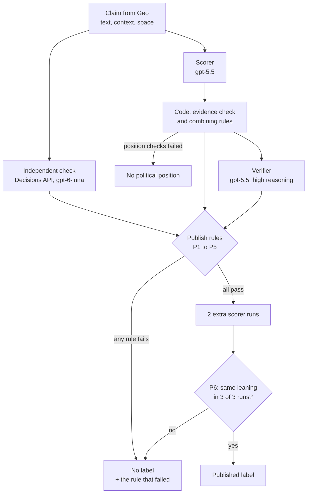
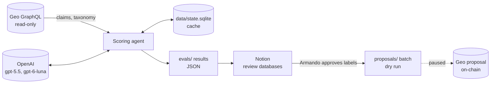

# POLARIS: Political leaning and ideology agent for Geo

POLARIS reads claims from the [Geo](https://www.geobrowser.io) knowledge graph and decides which **Political leaning** (Far left … Far right) and which **Ideology** (Socialist, Conservative, MAGA, …) each claim expresses. These are the values of a claim's **Leanings** property in Geo.

The project is built for one rule above all: **a wrong label is worse than no label.** A label is published only when several independent checks agree on it; otherwise the claim is left blank and the reason is recorded. Every result can be traced to numbered criteria and to the claim's exact words.

> **Status (23 Oct 2026):** framework v2.1. Submissions to Geo are **paused** at Armando's request while the scoring system is tested in Notion. The latest test (70 never-used claims, 10 per space) is waiting for Armando's review. See [Results so far](#results-so-far).

---

## Contents

1. [What the agent does](#what-the-agent-does)
2. [How one claim is scored](#how-one-claim-is-scored)
3. [The scoring framework](#the-scoring-framework)
4. [What a result looks like](#what-a-result-looks-like)
5. [Architecture](#architecture)
6. [Testing and evaluation](#testing-and-evaluation)
7. [Results so far](#results-so-far)
8. [Review in Notion](#review-in-notion)
9. [Publishing to Geo (paused)](#publishing-to-geo-paused)
10. [Setup](#setup)
11. [Commands](#commands)
12. [Repository layout](#repository-layout)
13. [Versions and history](#versions-and-history)
14. [Open decisions and known limits](#open-decisions-and-known-limits)

---

## What the agent does

For each claim, the agent returns exactly one of three results:

| Result | Meaning | Example |
|---|---|---|
| **Published label** | A leaning (one of Geo's seven) and/or ideologies. Every publish rule passed. | "The Department of Education should be abolished" → **Right** |
| **No label** | The claim may take a position, but at least one rule failed. The rule is named. | "Laws should follow Christian teaching…" → **No label (P4 Same level)** |
| **No political position** | The claim does not take a political position of its own. The failed check is named. | "Democrat James Talarico raised $64 million…" → **No political position (descriptive)** |

There are **no partial labels** such as "Potentially center left". Anything the agent is not sure of is left blank.

**Spaces in scope:**

| Space | Geo space ID |
|---|---|
| US Politics | `4582fbbee28a16589154f7e36f1ee3c5` |
| Health | `52c7ae149838b6d47ce0f3b2a5974546` |
| Crypto | `c9f267dcb0d270718c2a3c45a64afd32` |
| AI | `41e851610e13a19441c4d980f2f2ce6b` |
| World affairs | `89bd89bf28ff8a0963faf92a8c905e20` |
| Podcasts | `b5a31f8182b042437ede0f84ee02f104` |
| Relationships | `224406e0de3c48d78ef12774111b8b2f` |

**The values come from Geo itself:**
- Political leaning type `efa158a20ac34e63a31de1b103b1e7b0` has 7 values.
- Ideology type `bdb20cbb75a644c2bc2aa4d14aeef883` has 26 values in use. Geo also lists `Libertarian`, a duplicate of `Libertarianism`, which is excluded.
- The agent loads both lists live from Geo and refuses to run if they no longer match the framework.

---

## How one claim is scored

Three different models look at every claim, and code, not a model, decides the result.



1. **Scorer (gpt-5.5).** It reads the framework and the claim, then reports:
   - which of the four position checks pass;
   - which numbered criteria the claim matches, each with the claim's exact words as evidence;
   - which ideology beliefs it matches;
   - whether the claim is hedged, and which country it is about.

   It does **not** choose the final answer.
2. **Code.** Code throws away any evidence that is not word for word in the claim, applies the combining rules, and works out the candidate leaning.
3. **Independent check (OpenAI Decisions API, gpt-6-luna).** This check sees only the claim, its Geo space and the level definitions. It returns probabilities: that the claim takes a position, for each of the 7 leanings, and for each ideology. It never sees the scorer's answer.
4. **Verifier (gpt-5.5, high reasoning).** It checks the candidate leaning, and each ideology separately, against the full framework. It is told that approving a mistake is far worse than rejecting a correct result.
5. **Publish rules (code).** The leaning is published only if rules P1–P6 all pass. P6 is the stability rule: it scores the claim twice more and requires the same leaning every time. The extra runs are made only when P1–P5 already pass, so they cost little.
6. **Ideologies** have their own publish rules (I3 and I6, below). A focused "second look" asks about any ideology the independent check rates highly but the scorer missed.

Every model call is cached, so scoring the same claim again costs nothing (see [Caching](#caching-and-reproducibility)).

---

## The scoring framework

The framework is the written rulebook every result must cite. Its source is [`src/framework/rubric.ts`](src/framework/rubric.ts) (the criteria and rules) and [`src/framework/ideologies.ts`](src/framework/ideologies.ts) (the ideology cards). The full text is generated into [docs/FRAMEWORK.md](docs/FRAMEWORK.md) with `npm run cli -- framework`. The scorer's prompt is built from the same source, so changing a rule changes the agent. Every change bumps `FRAMEWORK_VERSION`.

### Step 1: does the claim take a political position?

All four checks must pass. Otherwise the result is **No political position**, naming the check that failed.

| Check | Passes when | Fails when |
|---|---|---|
| **G1** Takes a position | The claim argues for or against something ("should", "must", "is wrong", …) | Neutral facts, statistics, predictions, definitions |
| **G2** In its own voice | The position belongs to the claim itself | "X said", "according to", "a study found" |
| **G3** Political subject | Public policy, law, rights, government, the economy, how society is organized | Personal advice, business, technical or medical claims |
| **G4** Contested | Mainstream political camps disagree about it | Shared principles (democracy, rule of law), goals with no means |

### Step 2: match numbered criteria in five topic areas

Each topic area has criteria scored from −3 to +3. Each score corresponds to one of Geo's leanings.

| Topic area | Covers |
|---|---|
| **ECO** | Taxes, spending, welfare, labour, markets, regulation, housing, healthcare funding |
| **SOC** | Abortion, LGBTQ rights, family, religion in public life, race and identity, drugs |
| **NAT** | Immigration, refugees, citizenship, national identity |
| **LAW** | Policing, courts, guns, the death penalty, voting rules |
| **ENV** | Climate, pollution, energy |

A criterion ID encodes its score: `ECO-1L` is −1 (Center left), `NAT-2R` is +2 (Right), `SOC-0` is 0 (Center). Some topics, such as foreign policy, trade, technology, free speech and government structure, do not line up with left and right. They are recorded as **cross-cutting** and never scored.

### What each level means

The scorer, the independent check and the verifier all receive these same rules, so they place claims on one scale. (Before v2.0 they used different definitions and disagreed by one level in 24 of 27 doubtful cases.) **These rules are drafts until Armando approves them.**

| Level | Rule |
|---|---|
| Far left (−3) | Replaces capitalism, abolishes core institutions (police, prisons, borders, the family), or seeks power by revolution. |
| Left (−2) | Goes clearly beyond the center-left mainstream of the country, e.g. single-payer healthcare, a wealth tax, abolishing the immigration enforcement agency. |
| Center left (−1) | A position commonly held across the center-left mainstream, e.g. higher taxes on high earners, protecting abortion access, background checks for gun sales. |
| Center (0) | Explicitly combines or balances a left and a right position as a compromise. |
| Center right (+1) | A position commonly held across the center-right mainstream, e.g. lower taxes, voter ID, stronger border enforcement. |
| Right (+2) | Goes clearly beyond the center-right mainstream, e.g. a near-total abortion ban, ending birthright citizenship, abolishing a federal department. |
| Far right (+3) | Removes rights from people because of ethnicity, religion or sexuality, imposes religious rule, or ends elections or civil liberties for opponents. |

### Step 3: combining rules

| Rule | What it does |
|---|---|
| **C1** Country context | Places a position relative to the mainstream politics of the claim's country. The claim's Geo space counts as context (US Politics means the United States). |
| **E1** Evidence | Every criterion and ideology must quote the claim's exact words. |
| **H1** Hedged wording | "can", "may", "often" and similar words cap the score at ±1 (and P2 blocks publishing anyway). |
| **A1** Mixed signals | One topic area left and another right gives No label, never Center. |
| **A2** Combining | Several areas pointing the same way are averaged, rounded toward the center. |
| **A3** Center | Center is given only through a Center (`…-0`) criterion. |
| **A4** Far | Far left or Far right is given only through a ±3 criterion. |
| **A5** Between two levels | If the position sits between two levels, no criterion is matched. |

### Step 4: ideologies

Each of the 26 ideologies has a **definition card** listing its core beliefs. Each belief is marked *distinctive* (belongs to that ideology alone) or *shared* (neighbouring ideologies hold it too). A card also lists when it does **not** apply, its neighbouring ideologies, and where on the spectrum it is usually found. The cards are in Notion for Armando's approval.

An ideology is published only when **all** of these hold (rules I1–I6):
- the claim explicitly argues for one of its beliefs, quoted word for word. An ideology is never inferred from the topic alone;
- that belief is **distinctive**, not shared;
- the independent probability of the ideology is **at least 0.9**;
- the independent probability that the claim takes a position is at least 0.8;
- the ideology is usually found at the claim's leaning, when it has one;
- the verifier agrees;
- **I6:** no neighbouring ideology also fits the claim. When a neighbour's probability is 0.5 or more, the scorer takes a second look at it; if the claim matches the neighbour's beliefs too, the two cannot be told apart and neither is published;
- all 3 runs find it.

At most two ideologies are published per claim.

### Step 5: publish or leave blank

A leaning is published only when every rule passes:

| Rule | Passes when |
|---|---|
| **P1** Takes a position | All four position checks pass, and the independent probability that the claim takes a position is ≥ 0.8. |
| **P2** Full match | Every criterion behind the leaning matches directly or closely (not only in part), and the claim is not hedged. |
| **P3** Country clear | The country or region whose politics the claim is about is clear. |
| **P4** Same level | The independent check's most likely leaning is the **same exact level**, with probability ≥ 0.7. |
| **P5** Verifier agrees | The verifier agrees with the leaning. |
| **P6** Stable | The scorer gives the same leaning in all 3 runs. |

The thresholds live in `PUBLISH` in [`src/framework/rubric.ts`](src/framework/rubric.ts).

### No-hallucination guard

- **Evidence must be real.** Every quote (criterion evidence, ideology evidence) is checked word for word against the claim text; a quote that is not there is dropped.
- **The explanation is built by code.** It is made only from rule texts, numbers and those checked quotes. Before a result is returned, the agent checks every quoted span in the explanation once more and refuses to return a result that fails.
- **Model text is kept apart.** Notes the models write in their own words (the scorer's note on the position checks, verifier objections, second-look reasons) go to a separate field, **Reviewer notes (unverified)**. They never appear in the published explanation.
- **Only known values.** Criterion IDs and ideology names are limited to known values by the JSON schema of every model call.

---

## What a result looks like

`npm run cli -- score-text "The Department of Education should be abolished"`:

```
Result:      Right
Criterion:   ECO-2R (direct) “The Department of Education should be abolished”
Rule:        P1 pass: independent probability that the claim takes a position: 1.00
Rule:        P2 pass: the criteria match directly
Rule:        P3 pass: country: United States
Rule:        P4 pass: the independent check gives Right 1.00
Rule:        P5 pass: the verifier agreed
Rule:        P6 pass: all 3 runs gave Right
Why:         Published: Right. ECO-2R matched (direct): “The Department of Education should be abolished”. …
```

A claim the agent leaves blank shows the rule that blocked it:

```
Result:      No label (P4 Same level)
Criterion:   SOC-3R (direct) “Laws should follow Christian teaching because America is a Christian nation”
Rule:        P4 FAIL: the independent check prefers Right (0.97); Far right gets 0.01
Why:         No label. SOC-3R matched (direct): … That points to Far right, but rule P4 (Same level) failed: …
Not given:   Christian conservative: the claim also matches Traditionalist, Conservative (I6)
Model note:  Verifier on Conservative: … (unverified)
```

With `--json`, the full result is printed. It includes every rule check, the independent probabilities, the verifier's verdicts, the repeat runs, and the versions of the framework and models used.

---

## Architecture

### Components

| Component | Code | Role |
|---|---|---|
| **Geo read layer** | `src/geo/` | Read-only GraphQL client for `https://api-testnet.geobrowser.io/graphql`, with retries. Loads claims with their context, samples claims at random (random ID pivots, which avoid the API's 1000-row offset cap), and loads the live taxonomy and type definitions. |
| **Framework** | `src/framework/` | The rulebook as data: criteria, level rules, combining rules, publish rules, ideology cards. `render.ts` turns it into Markdown for the docs, Notion and the verifier. |
| **Scoring agent** | `src/agent/v3/` | `agent.ts` runs a claim through the steps above. `prompt.ts` builds the scorer prompt and output schema from the framework. `decisions.ts` runs the independent check. `verify.ts` runs the verifier. `score.ts` holds every decision rule as plain functions with unit tests (combining, P1–P6, ideology gate, quote checker). |
| **Run state** | `src/pipeline/state.ts` | SQLite cache (`data/state.sqlite`) for every model call. |
| **Evaluation** | `src/eval/`, `src/pipeline/fresh-set.ts` | Test-set benchmark, fresh samples of never-used claims, and verdicts and metrics. |
| **Publishing** | `src/publish/` | Builds proposal batches for approved claims, writes the exact Geo operations (with the Geo SDK), submits them (paused), and checks them after they execute. |
| **CLI** | `src/cli.ts` | Every command (see [Commands](#commands)). |
| **Notion export** | `scripts/notion-rows.mts` | Turns result files into Notion rows; they are written to Notion through the Notion MCP connector. |

### Data flow



### Safety checks built into the code

- **Taxonomy sync.** The agent stops if Geo's ideology list or type descriptions differ from the framework (for example, when Geo deleted Fascist and Zionist on 22 Oct 2026).
- **Live values.** Value IDs are looked up live from Geo, never typed by hand. The duplicate `Libertarian` is excluded in `src/config.ts`.
- **Submissions paused.** `SUBMISSIONS_PAUSED = true` in `src/config.ts` blocks `submit --yes`.
- **Approved claims only.** Proposals are built only for claims Armando approved (`dry-run --only`), and a claim is dropped if the agent no longer publishes its label.
- **No claim proposed twice.** A claim already in a proposal batch is never proposed again.

### Caching and reproducibility

Every model call is stored in SQLite under a key made of the call type, `FRAMEWORK_VERSION`, the model, the taxonomy fingerprint, the claim ID and, for repeat runs, the run number. As a result:
- re-running a command never pays twice for the same claim;
- changing the framework (a new version) automatically re-scores everything;
- a change to Geo's taxonomy (a new fingerprint) also re-scores everything.

Random samples use seeded randomness (`--seed`), so a sample can be rebuilt exactly.

---

## Testing and evaluation

### Test sets

| Set | What it is | Use |
|---|---|---|
| **Dev set** (`evals/dev-set.json`) | 41 hand-labelled edge cases | Early model choice (gpt-5.5 passed 41/41, gpt-5.4-mini 35/41) |
| **Test set v1** (`evals/test-set-v1.json`) | 106 claims: 80 real Geo claims from the 7 spaces and 26 written examples. Categories: clear, center, extreme, ideology, ambiguous or hedged, conflicting, and no-position traps | Benchmark (`bench`). Its expected answers were drafted by the developer and wait for Armando's review. |
| **Fresh sets** (`evals/fresh/`) | Random claims that were never used before: not in the dev set, QA rounds, test sets, proposals or earlier fresh sets | Honest measurement on claims the agent was never tuned on (`fresh-set`) |

### Verdicts and metrics

Only **published** labels can be wrong:

| Verdict | Meaning |
|---|---|
| Correct label | Something was published and all of it is acceptable |
| Correct blank | Nothing was published, and a blank is acceptable |
| Missed label | A leaning was expected but none was published (safe, but lower coverage) |
| **Wrong label / Wrong ideology** | A published label is not acceptable. **Target: 0.** |

Each run reports these numbers:
- wrong published labels;
- leaning and ideology precision (of what was published, how much was right);
- coverage (of claims that need a leaning, how many got the right one);
- the same numbers for real claims only, because the written examples are easier;
- stability (how often the 3 runs agree).

### Unit tests

`npm test` runs the vitest suite (85 tests). It covers every combining rule, each publish rule P1–P6 on its own, the ideology gate, the quote checker, the benchmark verdicts, fresh-set exclusions, taxonomy loading, sampling, and the proposal operations.

---

## Results so far

| Run | Framework | Claims | Outcome |
|---|---|---|---|
| run-1 | v1.2 (Clear / Potentially labels) | 106 (test set v1) | 3 wrong labels and 2 wrong ideologies, **all from "Potentially" labels**. In 24 of the 27 "Potentially" leanings, the independent check chose a different level. This led to v2. |
| run-2 | v2.0 | 19 of 106 (stopped: OpenAI credits ran out) | 8 labels published, **0 wrong**; all 8 stable in 3 of 3 runs. P4 stopped one would-be error. It also showed the scorer needed the claim's Geo space, which became v2.1. |
| fresh-seed3 | v2.1 | 70 never-used claims, 10 random per space | 1 label published ("Abortion is murder" → Right, every rule passed). The other 69 got No political position. **Waiting for Armando's verdicts.** |

**What this shows:**
- **Publish-or-blank removed the errors seen in run-1**, at the cost of coverage: more claims are left blank.
- **Random claims are rarely political** (1 in 70 here). A random sample checks that the agent leaves non-political claims alone. To measure label accuracy, the next test should use opinion claims, for example claims containing "should".
- **No test can prove 100%.** That is why Armando approves every label before it goes to Geo.

Result files are in `evals/results/` and `evals/fresh/`; the same results are in Notion.

---

## Review in Notion

The Notion hub **"Political Leaning & Ideology Agent"** is where results are documented and where Armando reviews them:

| Page or database | What it holds | What Armando does there |
|---|---|---|
| **Scoring framework v2.1** | The full rulebook, as in docs/FRAMEWORK.md | Comments on any criterion; decides the level rule |
| **Ideology definitions** | The 26 cards (plus Fascist and Zionist, marked deleted from Geo) | Edits cards and sets Status to Approved |
| **Test set and results** | Test set v1 with each run's result, rules and explanation | Confirms or corrects each expected answer (Armando review) |
| **Fresh QA sample (10 per space)** | Never-used claims with the agent's result | Gives each row a verdict: Correct / Wrong / Should be blank / Should have a label |
| **Runs** | One row per test run with its numbers | – |
| **Errors and improvements** | Every error found, its cause and the fix, with a status | Writes a decision on each proposed change |

Rows are produced with `npx tsx scripts/notion-rows.mts bench|fresh …`, which splits them into batches, and written through the Notion MCP connector.

---

## Publishing to Geo (paused)

The agent never writes to Geo by itself. When Armando lifts the pause, the steps are:

1. **Armando approves labels** in Notion.
2. **Build the batch:**
   ```sh
   npm run cli -- dry-run --space us-politics --only <id,id,…>
   ```
   This re-scores the approved claims (from cache), keeps only those still published, and writes `proposals/<space>/batch-NN/`:
   - `proposal.md`: a review checklist, the claims, and why each label;
   - `proposal.json` and `proposal.csv`;
   - `ops.json`: the exact `createRelation` operations, built with the Geo SDK. Each one links a claim to a value through the Leanings property.
3. **Check, then submit:**
   ```sh
   npm run cli -- submit --dir proposals/us-politics/batch-NN        # read-only checks, sends nothing
   npm run cli -- submit --dir proposals/us-politics/batch-NN --yes  # sends the proposal (needs GEO_PRIVATE_KEY)
   ```
   `--yes` is refused while `SUBMISSIONS_PAUSED` is true.
4. **After an editor votes it through:**
   ```sh
   npm run cli -- check-proposal --dir proposals/us-politics/batch-NN
   ```
   This confirms the Leanings now on Geo.

The submitting wallet is a member, not an editor, of US Politics, so its proposals need an editor's vote.

---

## Setup

Requires **Node.js 22.13 or later**.

```sh
npm install
cp .env.example .env      # then set OPENAI_API_KEY
npm run typecheck
npm test
```

| Variable | Needed for | Default |
|---|---|---|
| `OPENAI_API_KEY` | Anything that scores claims | – (required) |
| `OPENAI_MODEL` | Scorer and verifier model | `gpt-5.5` |
| `GEO_API_URL` | Geo GraphQL endpoint | `https://api-testnet.geobrowser.io/graphql` |
| `GEO_PRIVATE_KEY` | Only `submit --yes` (on-chain proposals) | – |

- **Geo:** reading from Geo needs no key.
- **OpenAI:** the account behind the key needs credits. Without them every call fails with `429 You have no credits remaining`.
- **Secrets:** `.env` is git-ignored. Never commit or print keys.

---

## Commands

All commands run as `npm run cli -- <command>`.

**Framework and Geo (no OpenAI key needed)**

| Command | What it does |
|---|---|
| `framework [--out docs/FRAMEWORK.md]` | Write the framework as Markdown |
| `taxonomy` | List the leaning and ideology values, live from Geo |
| `counts` | Count claims in each space |
| `claim <id> …` | Show claims with the context the agent sees |
| `sample <space> [--count N] [--seed N]` | Draw random claims from a space |
| `schema` | Save the live Geo GraphQL schema |

**Scoring and evaluation**

| Command | What it does |
|---|---|
| `score <id> … [--json]` | Score Geo claims and show the full result |
| `score-text "<sentence>" … [--json]` | Score any sentence (for example, test claims not on Geo) |
| `bench [--file evals/test-set-v1.json] [--concurrency N]` | Run the test set; writes `evals/results/bench.<set>.<framework>.json` |
| `fresh-set [--seed N] [--pool 10] [--per-space 10]` | Score never-used claims from every space (70 by default); writes `evals/fresh/fresh-seed<N>/fresh.json` |
| `eval3` | Run the agent over the dev set |

**Proposals (see [Publishing](#publishing-to-geo-paused))**: `dry-run`, `submit`, `check-proposal`.

**Earlier versions (kept for history):** `classify`, `eval`, `qa-sample` and `qa-report` use the v1/v2 classifier and its spreadsheet QA rounds (`qa/`).

---

## Repository layout

```
src/
  config.ts              Spaces, Geo IDs, excluded values, SUBMISSIONS_PAUSED, .env loading
  cli.ts                 Command-line entry point
  framework/
    rubric.ts            Criteria, level rules, combining rules, publish rules (FRAMEWORK_VERSION)
    ideologies.ts        The 26 ideology definition cards
    render.ts            Framework → Markdown (docs, Notion, verifier prompt)
  agent/v3/              Current scoring agent
    agent.ts             Runs one claim through every step; builds the explanation
    prompt.ts            Scorer prompt and output schema, built from the framework
    decisions.ts         Independent check (OpenAI Decisions API)
    verify.ts            Verifier
    score.ts             All decision rules as tested functions
  agent/*.ts             v1/v2 classifier and verifier (history; used by classify/eval/qa-sample)
  geo/                   Read-only Geo client, claims, taxonomy, schema
  pipeline/
    state.ts             SQLite cache of model calls
    fresh-set.ts         Never-used claim samples
    qa-sample.ts         Sampling helpers (and the v1/v2 QA rounds)
  eval/                  Test-set benchmark, verdicts and metrics; dev-set runners
  publish/               Proposal batches, Geo operations, submit, post-submit check
  qa/                    v1/v2 spreadsheet QA export and report
scripts/notion-rows.mts  Result files → Notion rows
docs/FRAMEWORK.md        The full framework (generated)
docs/PLAN.md             The original plan and early decisions
evals/                   Dev set, test set v1, results, fresh samples
proposals/               Proposal batches (dry runs)
qa/                      v1/v2 QA rounds
test/                    Unit tests (vitest)
data/                    Local cache and logs (git-ignored)
```

---

## Versions and history

| Version | What changed |
|---|---|
| **v1–v2 classifier** | A single prompt labelled each claim with a high/medium/low confidence, checked by a separate verifier. Reviewed in spreadsheet QA rounds. One proposal (1 claim) was sent to Geo; it was rejected. |
| **Framework v1.0–v1.2, agent v3** | After Armando asked for a transparent, objective scoring system: numbered criteria, quoted evidence, the independent check (Decisions API), a per-part verifier, a 0–100 confidence score and Clear/Potential labels. v1.2 followed Geo's deletion of Fascist and Zionist and its new Political leaning description. |
| **Framework v2.0** | After QA showed every error came from "Potentially" labels. Partial labels and the confidence score were replaced by publish-or-blank (P1–P6). It added: <ul><li>level rules shared by all three checks;</li><li>a stricter ideology gate (I3, I6);</li><li>four tightened ideology cards (Social democrat, Globalist, Isolationist, Neoliberal);</li><li>the no-hallucination guard;</li><li>proposals built only from approved claims.</li></ul> |
| **Framework v2.1** | Every check is told the claim's Geo space, so a claim in US Politics counts as being about the United States. |

The decision log, with every error found, its cause and its fix, is the **Errors and improvements** database in Notion.

---

## Open decisions and known limits

**For Armando to decide:**
1. **The level rule.** Is a mainstream party position *Center left / Center right* (as drafted) or *Left / Right*, as Geo's own value descriptions suggest?
2. **Ideology cards.** Approve the 26 cards, including the four changed in v2.0 and the Libertarianism text (which Geo does not describe).
3. **Confidence score.** v2.0 replaced the 0–100 confidence score he asked for with pass/fail rules (the probabilities are still shown). He needs to confirm that this is acceptable.
4. **Open framework questions.** Is a hate speech ban a social-left position or cross-cutting? Does a heavy carbon tax count as Environmentalist?
5. **Verdicts.** A verdict on each row of the Fresh QA sample, and a review of the test-set expected answers.

**Known limits:**
- **Coverage.** Publish-or-blank leaves many political claims blank. That is the chosen trade: a missed label can be added later, a wrong one does damage.
- **Political claims are rare.** Few Geo claims take a political position, so random samples contain few labels to check.
- **Criteria gaps.** Some clear positions are not named in the criteria yet (for example, death penalty abolition), so they get No label.
- **US focus.** The criteria examples are from US politics. Claims about other countries are placed relative to that country's mainstream, which is harder to judge.
- **No proof of 100%.** Even with every rule passing, Armando approves each label before it is proposed to Geo.
